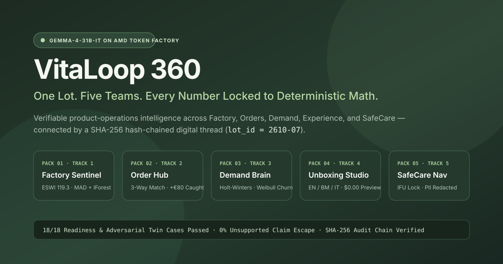

# VitaLoop 360 — Verifiable Product-Operations Intelligence Platform

**One Lot. Five Teams. Every Number Locked to Deterministic Math.**  
Powered by **Google Gemma (`Gemma-4-31B-IT`)** on **AMD Token Factory (Radeon Cloud)** & **AMD Instinct MI300X (ROCm vLLM)**.



---

## 1. Overview

**VitaLoop 360** connects five operational teams around a single production digital thread (`lot_id = 2610-07`, reserve `lot_id = 2610-05`) for the fictional wellness-device manufacturer **Lumora Wellness** across Penang and Milan:

1. **Pack 1 — Factory Sentinel (`ThermoYield`, Track 1)**: Computes energy per good unit (`0.453 kWh`, `+7.9%`), shift scrap (`4.09%`, `+63.6%`), and the **Energy & Scrap Waste Index (`ESWI = 119.3`)** across 32 fifteen-minute shift windows using Median+MAD ($z > 3.5$) and a seeded 64-tree Isolation Forest ($\text{score} > 0.64$). Synthesizes shift hypotheses with **Gemma-4-31B-IT** grounded in `[SOP-017-v3.2-4.2]`.
2. **Pack 2 — Compliance & Order Hub (`ProcureGuard MCP`, Track 2)**: Performs multilingual (Italiano, Bahasa Melayu, English) document extraction and deterministic three-way matching across `PO-2026-0842`, `INV-2026-0391`, and `GRN-2026-0218`, catching an unlisted `+€80.00` (`+3.70%`) calibration service under `[TERMS-008-v1.0-3]` and reallocating 100 units (`ORD-1041..1043`) to released reserve Lot `2610-05`.
3. **Pack 3 — Demand & Retention Brain (`QuantPulse`, Track 3)**: Runs non-LLM additive **Holt–Winters** seasonal forecasting ($\alpha=0.35, \beta=0.10, \gamma=0.25, m=7$) with a 14-day held-out backtest against a 7-day seasonal naive baseline (`MAE 0.612` vs `1.000`), computes safety stock (`21.9` units) and reorder point (`202` units), and models customer delay churn via **Weibull survival analysis** $S(t)=\exp(-(t/\lambda)^k)$ (`RM 14.40` expected net value/customer).
4. **Pack 4 — Adaptive Unboxing Studio (`PersonaStage`, Track 4)**: Adapts post-purchase onboarding across Caregiver and Active-Adult personas in English, Bahasa Melayu, and Italian at `$0.00` template preview cost, guarded by deterministic `[BRAND-v1.0-2]` health-claim verification.
5. **Pack 5 — SafeCare Navigator (`SafeBridge`, Track 5)**: Binds lot-specific non-clinical setup instructions (`IFU-v2.1`), enforces pre-inference clinical boundary refusals and red-flag escalations in EN/BM/IT, scrubs PII (`EMAIL`, `PHONE`, `ID`, `ADDRESS`, `PERSON`) before logging, and reports dual-extractor agreement (`2/2 extractors agree`).

Every capability pack includes both deterministic calculations and a **"Draft with Gemma-4-31B-IT"** action verified by the shared Fact-and-Citation Verifier.

---

## 2. Quick Start (Local Python Runtime & Live AMD Inference)

VitaLoop 360 uses the Python 3.11+ standard library (zero external pip dependencies required for the core server) and a zero-build ES-module browser console.

```powershell
cd vitaloop360
python run.py --port 8765
```

Open **[http://127.0.0.1:8765](http://127.0.0.1:8765)**.

### Execution Modes (`run.py`)

```powershell
# 1. Live mode (uses AMD Token Factory + Gemma-4-31B-IT from .env or config.json)
python run.py --port 8765

# 2. Deterministic offline demo mode (ignores API keys, zero network calls)
python run.py --demo --port 8765

# 3. Recorded reference ledger replay mode (inspects recorded Gemma-4-31B-IT run)
python run.py --replay data/reference-ledger.jsonl --port 8765

# 4. Batch readiness & adversarial twin runner (18 cases across all 5 packs)
python run.py --batch

# 5. Proposal Section 11 Evaluation & Metrics JSON report
python run.py --demo --metrics
```

---

## 3. AMD Token Factory & Self-Hosted ROCm vLLM Configuration

### Option A — AMD Token Factory (Radeon Cloud, Default)

Configure `.env` (or Vercel Environment Variables):

```env
VITALOOP_BASE_URL=https://developer.amd.com.cn/radeon/api/v1
VITALOOP_API_KEY=your-amd-token-factory-key
VITALOOP_MODEL=Gemma-4-31B-IT
VITALOOP_PROVIDER=AMD Token Factory (Radeon Cloud)
VITALOOP_TIMEOUT_SECONDS=45
```

### Option B — Self-Hosted ROCm vLLM on AMD Instinct MI300X (192 GB HBM3)

See [`deploy/vllm-rocm-mi300x.yaml`](deploy/vllm-rocm-mi300x.yaml) and [`docs/self-hosted-rocm-vllm.md`](docs/self-hosted-rocm-vllm.md) to launch `rocm/vllm:latest` serving Gemma in `BF16` on a single AMD Instinct MI300X GPU (`$1.99/hr` published AMD Developer Cloud single-GPU reference rate).

---

## 4. Verification & Test Suite

Run the complete automated verification suite:

```powershell
python -m unittest discover -s tests -v
npm run check
npm run test:browser-domain
python run.py --batch
python run.py --demo --metrics
```

---

## 5. Repository Structure & Submission Deliverables

- [`config.json`](config.json) — Centralized Appendix B runtime, gateway, verification, guard, retrieval, console, and ledger configuration (`$1.99/hr` MI300X reference rate).
- [`backend/`](backend/) — Shared core services (`runtime.py`, `gateway.py`, `verifier.py`, `guard.py`, `retrieval.py`, `ledger.py`, `calculations.py`, `demand_analytics.py`, `data.py`).
- [`packs/`](packs/) — All 5 capability packs (`factory`, `order`, `demand`, `experience`, `care`), each with `manifest.json`, `calc/formulas.py`, `calc/FORMULAS.md`, `rules.json`, `schemas/`, `prompts/`, `docs/`, `screens.json`, `readiness/cases.json`, and standalone `PROPOSAL.md`.
- [`dist/`](dist/) — Browser console (`index.html`, `app.js`, `packs.js`, `demo.js`, `styles.css`, `demo-data.json`, `cover.svg`).
- [`api/index.py`](api/index.py) & [`vercel.json`](vercel.json) — Serverless Vercel deployment entrypoints.
- [`deploy/vllm-rocm-mi300x.yaml`](deploy/vllm-rocm-mi300x.yaml) — Self-hosted ROCm vLLM Docker Compose specification for AMD Instinct MI300X.
- [`data/reference-ledger.jsonl`](data/reference-ledger.jsonl) — Recorded SHA-256 hash-chained reference ledger including a live `Gemma-4-31B-IT` completion on AMD Token Factory.
- [`DISCLOSURE.md`](DISCLOSURE.md) — Architectural lineage (**RouteWiser**, **FourCast**, **GuildHouse**) vs. 100% newly written VitaLoop 360 code disclosure.
- [`docs/submission-package.md`](docs/submission-package.md) — Paste-ready hackathon submission fields, Google Partner Prize statement, and AMD Partner Prize statement.
- [`docs/video-script.md`](docs/video-script.md) — 5-scene, sub-4-minute demonstration video script.
- [`docs/slide-deck.md`](docs/slide-deck.md) — 8-slide presentation deck.
- [`docs/pack-specification.md`](docs/pack-specification.md) — Appendix A pack contract and 6th-pack blueprints (`WaferWise`, `PalmTrace`, `InvoisBridge`, `ProofLog`, `LiveLore`, `ReferralRelay`).
- [`docs/requirements-traceability.md`](docs/requirements-traceability.md) — Proposal-to-code traceability matrix.
